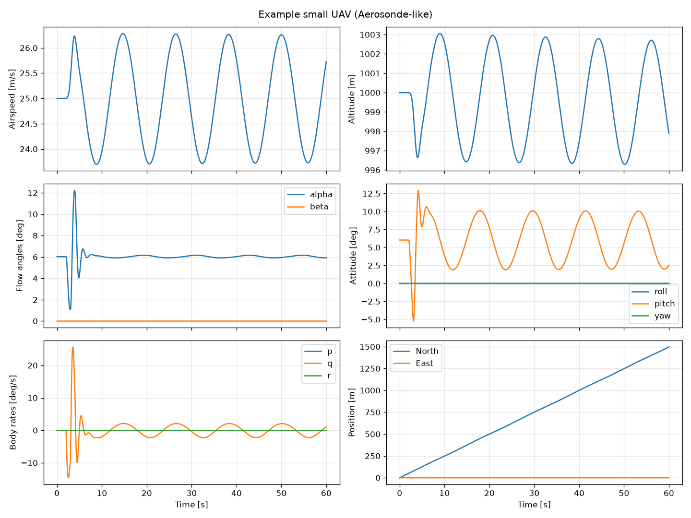

# 6-DOF Fixed-Wing Flight Simulator

A nonlinear six-degrees-of-freedom (6-DOF) flight dynamics simulator for fixed-wing aircraft, written in Python.

The simulator models the aircraft as a rigid body, computes aerodynamic, propulsive and gravitational forces and moments, and integrates the full nonlinear equations of motion over time. Each component is checked against analytical solutions and conservation laws.

> **Status:** v0.1.0. The core simulator works and is tested: rotations, atmosphere, aerodynamics, equations of motion, RK4 integration, level-flight trim and plotting. See the [roadmap](#roadmap) for what comes next.



*Response of the example UAV to a ±3° elevator doublet from trimmed flight at 25 m/s. The short-period mode damps out within a few seconds; the lightly damped phugoid (period ≈ 11.7 s) continues.*

---

## Goals

- Implement the nonlinear 6-DOF rigid-body equations of motion.
- Model aerodynamic forces and moments using stability and control derivatives.
- Simulate the aircraft's response to control-surface and throttle inputs.
- Integrate the state numerically, with controlled and measurable error.
- Verify every component against analytical and reference solutions.
- Visualize flight trajectories and aircraft attitude.

## Quick Start

```python
import numpy as np
from flightsim import Controls, example_aircraft, simulate
from flightsim.trim import trim_level_flight
from flightsim.plotting import plot_time_history

aircraft = example_aircraft()

# Find the alpha, elevator and throttle for steady level flight
trim = trim_level_flight(aircraft, airspeed=25.0, altitude=1000.0)

# Apply a 1-second, 3-degree elevator pulse at t = 2 s
def pulse(t):
    de = np.radians(3.0) if 2.0 <= t < 3.0 else 0.0
    return Controls(elevator=trim.controls.elevator + de, throttle=trim.controls.throttle)

result = simulate(aircraft, trim.state, duration=30.0, dt=0.01, controls=pulse)

print(result.altitude[-1], np.degrees(result.euler_angles[-1]))
plot_time_history(result).savefig("results/pulse.png")
```

You can also run the bundled example, which saves figures to `results/`:

```bash
python examples/elevator_doublet.py
```

## Modeling Approach

| Aspect | Choice |
|---|---|
| Body model | Rigid body, constant mass and inertia |
| Earth model | Flat, non-rotating Earth (NED frame treated as inertial) |
| Attitude | Unit quaternions in the state; Euler angles (3-2-1) used only for input and display |
| Aerodynamics | Linear stability and control derivatives, parabolic drag polar |
| Propulsion | Thrust proportional to throttle and air density, along body x |
| Atmosphere | International Standard Atmosphere (ISA), −610 m to 20 km |
| Integration | Fixed-step classical RK4, with quaternion renormalisation each step |

These assumptions are standard for flight times and speeds where Earth's curvature and rotation are negligible. They are stated up front so the limits of the results are clear. See [docs/architecture.md](docs/architecture.md#known-limitations) for the full list of limitations.

### State Vector

The aircraft state is a 13-element vector, defined in [`src/flightsim/state.py`](src/flightsim/state.py):

| Index | Symbol | Description | Frame | Units |
|---|---|---|---|---|
| 0–2 | `x_N, y_N, z_N` | Position | NED | m |
| 3–5 | `u, v, w` | Translational velocity | Body | m/s |
| 6–9 | `q0, q1, q2, q3` | Attitude quaternion (scalar first) | NED → Body | – |
| 10–12 | `p, q, r` | Angular velocity | Body | rad/s |

### Equations of Motion

```
v̇      = F/m − ω × v                   (translational, body axes)
ω̇      = J⁻¹ (M − ω × Jω)              (rotational, body axes)
q̇      = ½ Ω(ω) q                      (attitude kinematics)
ṗ_NED  = C_bnᵀ v                       (navigation)
```

### Conventions

- **Units:** SI throughout. Angles are in radians internally.
- **Earth frame:** North-East-Down (NED). Altitude is `h = −z_N`.
- **Body frame:** x forward, y out the right wing, z down.
- **Rotation sequence:** yaw (ψ) → pitch (θ) → roll (φ).
- **Controls:** positive elevator gives a nose-down moment, positive aileron gives right-wing-down roll, positive rudder gives nose-left yaw, and throttle ranges from 0 to 1.

## Getting Started

### Prerequisites

- Python 3.13
- Git

### Installation

```bash
git clone <repository-url>
cd 6dof-fixed-wing-flight-simulator

python -m venv .venv
```

Activate the virtual environment:

```bash
# Windows (PowerShell)
.venv\Scripts\Activate.ps1

# macOS / Linux
source .venv/bin/activate
```

Install the dependencies and the `flightsim` package in editable mode:

```bash
pip install -r requirements.txt
pip install -e .
```

### Running Tests

```bash
pytest
```

The suite has 49 tests and runs in about 10 seconds.

## Repository Structure

```
6dof-fixed-wing-flight-simulator/
├── src/flightsim/        # Simulator package
│   ├── rotations.py      #   Euler / quaternion / DCM conversions and kinematics
│   ├── state.py          #   State vector layout and builder
│   ├── atmosphere.py     #   ISA atmosphere model
│   ├── controls.py       #   Control input definition and sign conventions
│   ├── aircraft.py       #   Aircraft parameters and example UAV
│   ├── aerodynamics.py   #   Aerodynamic forces and moments
│   ├── propulsion.py     #   Thrust model
│   ├── dynamics.py       #   6-DOF equations of motion
│   ├── integrators.py    #   Euler and RK4 step functions
│   ├── simulation.py     #   Simulation loop and results container
│   ├── trim.py           #   Level-flight trim solver
│   └── plotting.py       #   Standard plots
├── tests/                # Verification tests (one file per module group)
├── examples/             # Runnable demonstration scripts
├── notebooks/            # Numerical experiments and exploratory analysis
├── docs/                 # Architecture notes and derivations
├── results/              # Generated figures (not tracked by git)
├── pyproject.toml        # Package metadata and pytest config
└── requirements.txt      # Development dependencies
```

For a description of every file and how they fit together, see [docs/architecture.md](docs/architecture.md).

## Roadmap

**Phase 1: Foundations** ✅
- [x] Repository setup and packaging
- [x] Coordinate frames and rotations (DCM, Euler angles, quaternions)
- [x] Unit tests for rotation kinematics

**Phase 2: Rigid-Body Dynamics** ✅
- [x] Translational and rotational equations of motion
- [x] Verification: ballistic trajectory, torque-free motion, energy and momentum conservation

**Phase 3: Environment and Aerodynamics**
- [x] ISA atmosphere model
- [x] Linear aerodynamic force and moment model
- [x] Placeholder propulsion model
- [ ] Wind and turbulence (Dryden model)
- [ ] Nonlinear aerodynamics including stall
- [ ] Propeller model
- [ ] Load aircraft parameters from files (YAML/JSON)

**Phase 4: Simulation**
- [x] Fixed-step RK4 integrator and step-size convergence test
- [x] Trim solver for steady, wings-level flight
- [x] Response to time-varying control inputs (doublets, steps)
- [ ] Adaptive integration with SciPy `solve_ivp` for comparison
- [ ] Trim for climbing and turning flight
- [ ] Actuator dynamics and control-surface limits

**Phase 5: Analysis and Validation**
- [ ] Linearization about trim and dynamic mode identification (short period, phugoid, Dutch roll, spiral, roll subsidence)
- [ ] Comparison with published reference data
- [ ] Animated attitude visualization

## Verification Strategy

Each module is tested on its own before it is combined with the others:

1. **Property tests:** rotation matrices stay orthonormal, quaternions keep unit norm, and frame conversions round-trip.
2. **Analytical solutions:** gravity-only flight matches the closed-form parabola, and a spin about a principal axis stays steady.
3. **Conservation checks:** torque-free tumbling conserves rotational kinetic energy and angular momentum.
4. **Convergence studies:** halving the time step cuts RK4 error by about 16×, as 4th-order accuracy predicts.
5. **Physical sanity checks:** lift, drag, control and damping derivatives produce moments of the correct sign, and a trimmed aircraft holds altitude and airspeed.
6. **Reference comparison** *(planned):* trim conditions and dynamic modes against textbook values.

## Technologies

- **Python 3.13**
- **NumPy:** linear algebra and array computation
- **SciPy:** nonlinear equation solving (trim)
- **Matplotlib:** plotting and visualization
- **Jupyter:** numerical experiments
- **pytest:** testing

## References

- B. L. Stevens, F. L. Lewis, E. N. Johnson, *Aircraft Control and Simulation*, 3rd ed., Wiley, 2016.
- R. W. Beard, T. W. McLain, *Small Unmanned Aircraft: Theory and Practice*, Princeton University Press, 2012.
- R. C. Nelson, *Flight Stability and Automatic Control*, 2nd ed., McGraw-Hill, 1998.

## Changelog

See [CHANGELOG.md](CHANGELOG.md).

## Author

Matthew Lac
